<!-- ───────────────────────────────────────────────────────────────
  Profile README for KB1708. Cards are rendered by .github/workflows/profile.yml
  into the `output` branch. Edit profile.json to change text, then let the
  workflow run (or trigger it from the Actions tab).
──────────────────────────────────────────────────────────────── -->

<p align="center">
  
</p>

<p align="center">
  
  <a href="https://github.com/KB1708?tab=followers"></a>
  
  
</p>

## `> cat about_me.yml`

I design and build AI applications that make it from prototype to production: LLM-powered products, retrieval-augmented generation pipelines and agentic workflows, deployed and scaled on AWS.

```yaml
name:      KB
role:      Member of Technical Staff – Applied AI (MTS-1)
company:   GOML
location:  Coimbatore, Tamil Nadu, India
focus:
  - Generative AI applications: LLM apps, RAG, AI agents
  - Production GenAI on AWS: Bedrock, SageMaker, serverless
  - Evaluation, guardrails and cost-efficient inference
principle: "Ship AI that works in production, not just in notebooks."
```

## `> ls ~/stack`

<b><code>$ ls ~/stack/languages</code></b><br/>


<br/><br/>

<b><code>$ ls ~/stack/genai</code></b><br/>


<br/><br/>

<b><code>$ ls ~/stack/ml-data</code></b><br/>


<br/><br/>

<b><code>$ ls ~/stack/aws</code></b><br/>


<br/><br/>

<b><code>$ ls ~/stack/apps</code></b><br/>


<br/><br/>

<b><code>$ ls ~/stack/devops</code></b><br/>


<br/><br/>

## `> ls ~/projects --featured`

<p align="center">
  <a href="https://github.com/KB1708/Fittrack_Pro"></a>
  <a href="https://github.com/prabha55555/Cognitive_Load_Analysis"></a>
  <a href="https://github.com/KB1708/jarvis-personal-assistant"></a>
</p>

## `> neofetch --github`

<p align="center">
  
</p>
<p align="center">
  
  
</p>
<p align="center">
  
</p>

## `> ./snake --eat contributions`

<p align="center">
  
</p>

<!-- ── Connect (optional) ─────────────────────────────────────────
  Uncomment and fill in when you want contact links on the profile.

## `> ping kb`

<p align="center">
  <a href="https://www.linkedin.com/in/YOUR-HANDLE"></a>
  <a href="https://YOUR-SITE"></a>
</p>
──────────────────────────────────────────────────────────────── -->

<p align="center">
  
</p>
